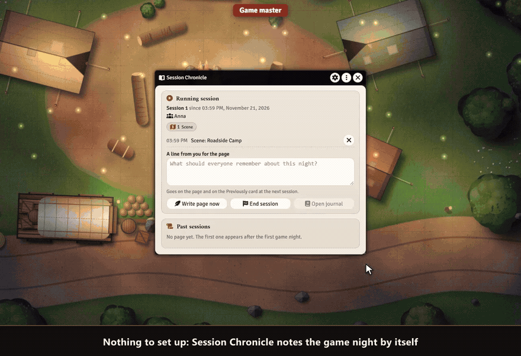

# Sephral’s Session Chronicle

**Your players ask what happened last time, and you spend the first ten minutes of the evening remembering.** Session Chronicle writes up every game night for you, without any AI: one journal page per session, a "Previously" card at the next start, and a private "What you missed" card for players who come late.

[](#install)
[](https://discord.gg/7BjCgDYaBP)
[](https://github.com/Sephral)



## Highlights

* **You do nothing.** The module notices what happens while players are online. No setup, no button to remember.
* **One page per game night.** Who was at the table, the fights with rounds and defeated foes, level ups, loot, every picture and handout you showed, and the natural 20s and 1s.
* **No AI, only facts.** Every sentence is built from what really happened, so the page never invents a thing. You add a line of your own, and that is the part that reads like a story.
* **"Previously" at the next start.** A card in the chat tells everybody the story of last time and opens the full page.
* **"What you missed" for late players.** Whoever comes late or back after a break gets a private card with the highlights they missed.
* **Finds the sessions by itself.** A few hours of quiet end a session, also across midnight.
* **Grows with your other Sephral modules.** Combat numbers, album photos and loot come onto the page when Combat Log and Stats, Campaign Album or Loot Ledger are active.
* **Yours to keep.** Pages are ordinary journal pages in a journal called Chronicle. Edit them, share them, back them up.
* **English and German.**

## How it works

1. Enable the module in your world. Nothing else to set up.
2. Play. The window from the token controls shows what has been noted, and you can add a line for the page.
3. The page appears after the session. At the next one everybody sees "Previously".

## Good to know

Recording needs a player online, so your preparation never turns into a session. Whispers and rolls of monsters are never noted.

## Install

Session Chronicle is not in Foundry's module search. Copy this link:

```text
https://github.com/Sephral/sephrals-session-chronicle/releases/latest/download/module.json
```

1. In Foundry's setup screen open **Add-on Modules** and click **Install Module**.
2. Paste the link into **Manifest URL** at the bottom of the window.
3. Click **Install**, then enable the module in your world.

On The Forge open the Bazaar, click **Install From Manifest** and paste the link.


Foundry VTT 13 and 14 · any game system · English and German

## Learn more

Every setting and the macro API are explained in the [manual](MANUAL.md). Questions or ideas? Join us on [Discord](https://discord.gg/7BjCgDYaBP). Looking for more? See [all modules by Sephral](https://github.com/Sephral).

## License

See [LICENSE.md](LICENSE.md).
